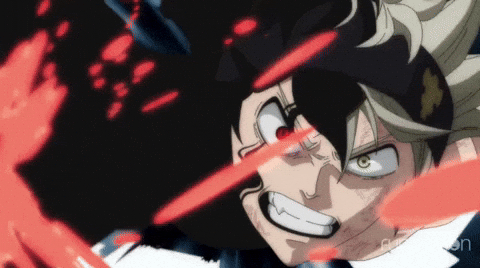

---

### 🐾 About me

- 🎓 Final-year **B.Tech, Computer Science & AI** at Newton School of Technology
- 💼 Former **SDE Intern at Incanus Technologies**, where I worked on the student portal of a placement-prep platform
- 🛠️ I like taking a real problem, understanding what people actually need, and shipping something that works
- 📏 I measure what I build instead of guessing
- 🤖 I build with AI coding tools like Claude Code, and keep my own rules and checks so the AI's mistakes don't ship
- 🎸 Outside code, I sing, play the guitar, and rewatch Black Clover (Asta & Captain Yami fan)

---

### ⚔️ Black Bulls energy

  
  

<i>"Surpass your limits. Right here, right now."</i> — Captain Yami

<b>No magic? Then outwork everyone.</b> That's the Asta way, and mine. 🗡️

---

### 🚀 Things I've built

| Project | What it does | Links |
|---|---|---|
| **Cortexa** | AI assistant that answers from your own documents, with citations. Routes each request to 1 of 5 modes; an agent uses 14 tools; Postgres with row-level security; MCP server | [Live](https://cortexa-kappa.vercel.app) · [Code](https://github.com/Zakuroooo/Cortexa) |
| **Krishi Mitr** | Voice-first app for farmers (Smart India Hackathon 2026). 50 screens in English, Hindi and Marathi, offline-first, 220 tests. I led the frontend | [Live](https://krishimitr.in) · [Code](https://github.com/Zakuroooo/Krishi-Mitr) |
| **High-Density Object Segmentation** | Counts objects in crowded photos. Fine-tuned YOLOv8s-seg; a density-aware second pass raised count accuracy from 52% to 64%; runs in the browser | [Demo](https://huggingface.co/spaces/Pranay004/high-density-object-segmentation) · [Code](https://github.com/Zakuroooo/high-density-object-segmentation) |
| **FollowUp** | Lead follow-up tool for a small service business: rules pick who to call, AI drafts messages, the owner stays in control | [Code](https://github.com/Zakuroooo/FollowUp) |

---

### 🧰 Tools I use

  
   
  

---

### 📊 GitHub stats

  
  

  

